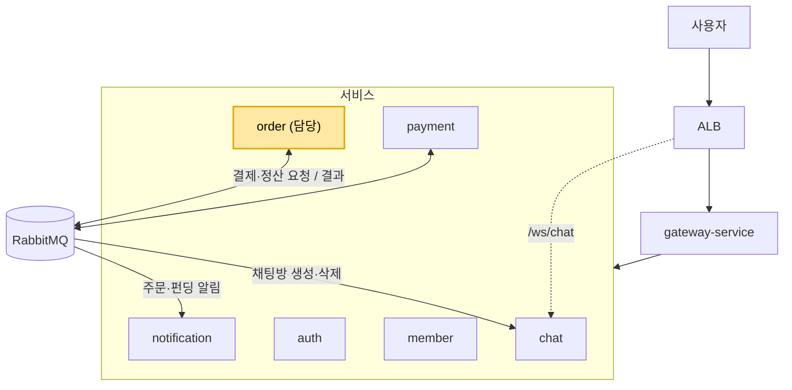
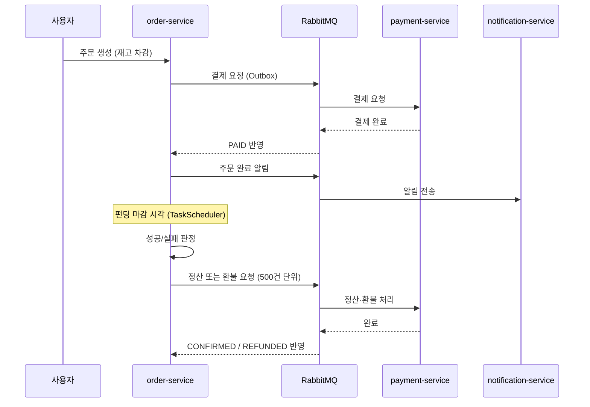
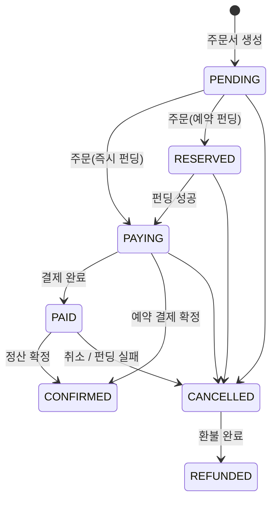
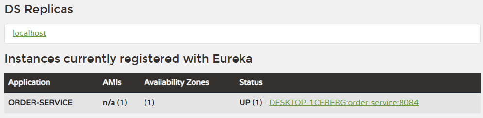
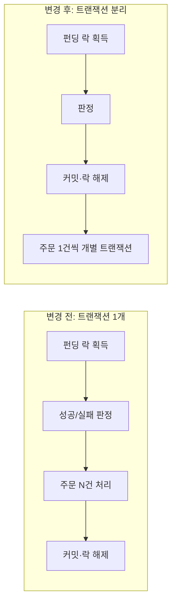
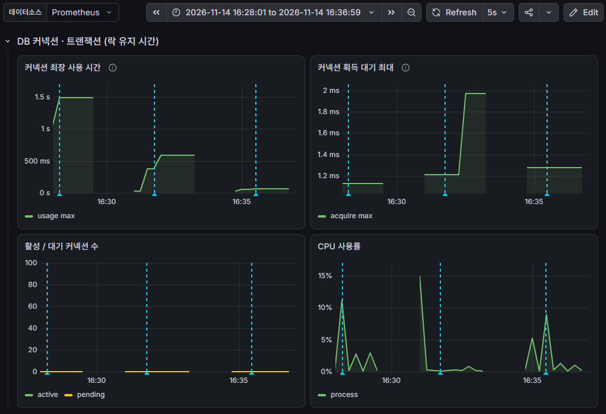
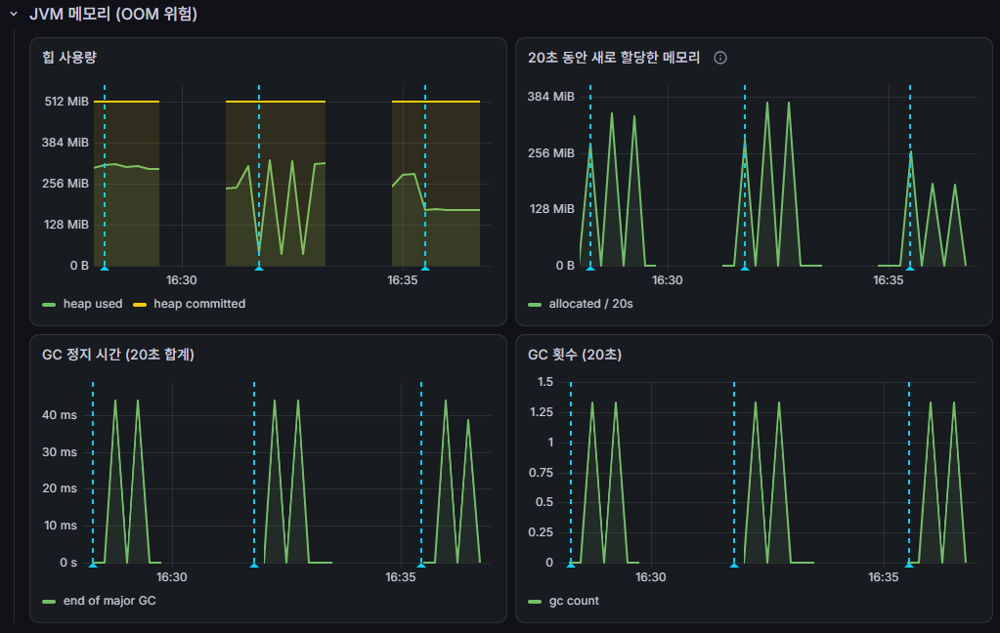
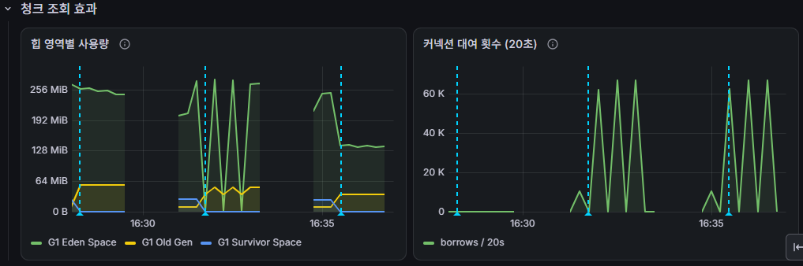

# 빵디즈 (BDS)

> 실시간 공개 토론방이 붙은 커뮤니티형 크라우드 펀딩 플랫폼 (MSA 백엔드)

| 항목 | 내용 |
|---|---|
| 기간 | 2026.06 ~ 2026.07 (5주) |
| 유형 | 팀 프로젝트 (kt cloud Tech Up 부트캠프 백엔드 과정) |
| 인원 | 5명 (BE 5) |
| 내 역할 | 주문·펀딩 서비스(order-service) 전체, 서비스 간 이벤트 계약(bds-events) 일부 |
| 링크 | 원본 레포: [KT-Cloud-2-BDS/bds_backend](https://github.com/KT-Cloud-2-BDS/bds_backend) · [팀 프로젝트 상세 문서](docs/team-project.md) |


## 프로젝트 개요

### 배경
기존 펀딩 플랫폼은 후원자와 창작자, 후원자끼리 직접 소통할 수단이 부족해 달성률 외에는 상품의 실제 필요성을 가늠하기 어려웠습니다. 그래서 펀딩마다 실시간 공개 토론방을 열어 후원 전에 충분히 의견을 나눌 수 있는 플랫폼을 기획했습니다. 백엔드는 도메인별 독립 서비스로 나눈 MSA 구조로 개발했습니다.

### 목표
- All-or-Nothing 펀딩: 마감 시점에 목표 금액 미달이면 전액 자동 환불
- 서비스 간 비동기 메시징 환경에서 주문·결제·재고 데이터 정합성 유지
- 펀딩 상세 화면의 공개 토론방과 펀딩 생명주기 실시간 알림 제공

## 기술 스택

| 분류 | 기술 |
|---|---|
| Backend | Java 25, Spring Boot 4.1, Spring Data JPA, Spring Modulith 2.1, Spring Cloud (Gateway, Eureka, OpenFeign), Spring Security, OAuth2, JWT, WebSocket, JUnit 5, Testcontainers |
| Database | PostgreSQL 18, MySQL, Redis, Flyway |
| Infra / DevOps | RabbitMQ, Docker, GitHub Actions, Prometheus, Grafana, k6 |

---

## 프로젝트 소개

### 주요 기능

| 기능 | 서비스 | 설명 | 담당 |
|:---|:---|:---|:---|
| **펀딩 주문** | order | 상품 상세에서 리워드 선택 → 주문서 확인 → 결제 진입, 마감 시 펀딩 성공·실패 판정 | 손하영 ([@glosona](https://github.com/glosona)) |
| **자체 월렛 결제** | payment | 사이트 전용 월렛 충전 후 펀딩 참여, 프로젝트 실패·취소 시 자동 환불 | 김재성 ([@semolu99](https://github.com/semolu99)) |
| **실시간 채팅** | chat | 펀딩별 공개 토론방, 메이커-서포터 1:1 문의 채팅 | 주병규 ([@jnj3j3](https://github.com/jnj3j3)) |
| **실시간 알림** | notification | 펀딩 시작·성공·실패, 주문 완료·환불 등 생명주기 알림 (SSE) | 조형욱 ([@HyoungUkJo](https://github.com/HyoungUkJo)) |
| **회원·인증** | auth, member, gateway | 이메일 인증 가입, 네이버 소셜 로그인, JWT 발급 및 게이트웨이 인증 | 노여진 ([@jinjinjala-ish](https://github.com/jinjinjala-ish)) |

### 시스템 구조



- 도메인별 서비스 분리, 게이트웨이에서 JWT 검증 후 각 서비스로 라우팅
- 서비스 간 통신은 RabbitMQ 기반 비동기 이벤트, 발행은 Spring Modulith 이벤트 외부화(Outbox) 사용

> 서비스별 역할, 인증·이벤트 흐름, 배포 구성, ERD, API 문서는 [팀 프로젝트 상세 문서](docs/team-project.md)에 정리

---

## 주문(펀딩) 서비스 구현

order-service 전체(펀딩·리워드·주문 도메인)와 서비스 간 이벤트 계약 중 주문·펀딩 이벤트를 담당함.

### 담당 업무

| 담당 | 내용 |
|---|---|
| 주문 API | 주문서 생성 → 주문 생성(재고 차감) → 취소/환불 요청, 내 주문 목록·상세 조회 구현 |
| 펀딩 API | 펀딩 생성(리워드 포함), 상태·유형별 목록 조회, 상세 조회 구현 |
| 펀딩 생명주기 | `TaskScheduler`로 시작 시각 활성화·마감 시각 판정 예약, 서버 재시작 시 누락 일정 보정 |
| 판정 후 주문 처리 | 성공/실패·즉시/예약 펀딩별 정산·환불 요청을 500건 단위 커서 조회로 일괄 처리 |
| 이벤트 연동 | 결제·정산·환불 요청 발행, 결제 결과(paid/cancelled/settled) 수신 후 주문 상태 반영 |
| 복구 배치 | 판정 후 처리되지 않은 주문을 매일 새벽 재처리하는 복구 스케줄러 구현 |
| 테스트·CI | 단위·통합 테스트 291개 작성, Testcontainers(PostgreSQL·RabbitMQ) 통합 테스트, JaCoCo 70% 커버리지 기준을 빌드에 적용 |

### 주문·펀딩 흐름



### 즉시 펀딩 / 예약 펀딩
- 즉시 펀딩(INSTANT): 주문 시 바로 결제, 마감 후 성공이면 정산·실패면 환불
- 예약 펀딩(RESERVED): 주문 시 결제 없이 예약, 마감 후 성공한 경우에만 일괄 결제

### 주문 상태 흐름



- 상태 전이 규칙을 도메인 모델(`Order.canTransitTo`)에 두고, 허용되지 않은 전이는 예외로 차단
- 재고 차감은 `remainQty >= qty` 조건부 UPDATE로 처리해 초과 판매 방지
- 주문 행은 비관적 락(`PESSIMISTIC_WRITE`, 타임아웃 3초)으로 조회해 동시 상태 변경 방지

## 트러블슈팅

| # | 문제 | 해결 키워드 |
|---|---|---|
| 1 | Eureka Client 추가 후 애플리케이션 시작 실패 (빈 중복 정의) | Jackson 2.x용 자동 구성 제외 |
| 2 | 결제 요청 이벤트가 Outbox에 기록되지 않음 | 이벤트 외부화 설정 직접 등록 |
| 3 | 펀딩 마감 판정 시 대량 주문 처리로 인한 락 점유·메모리 부담 | 트랜잭션 분리, 커서 기반 500건 단위 조회 (락 대기 약 0.8초 → 없음) |

### 1. Eureka Client 추가 후 애플리케이션 시작 실패 (빈 중복 정의)

**문제 상황**

> Eureka Client를 추가하자 `rabbitTemplateCustomizer` 빈이 두 번 등록되며 애플리케이션 실행과 전체 테스트가 실패함

- 환경: Spring Boot 4.1.0, Spring Modulith 2.1.0 (AMQP 이벤트 외부화), Spring Cloud 2025.1.2 (Eureka Client)
- 게이트웨이·서비스 디스커버리 적용을 위해 루트 `build.gradle`에 `spring-cloud-dependencies` BOM과 Eureka Client를 추가한 직후부터 발생
- 영향 범위: 애플리케이션 실행, 슬라이스·통합 테스트 전체

```text
The bean 'rabbitTemplateCustomizer', defined in class path resource
[org/springframework/modulith/events/amqp/RabbitJacksonConfiguration.class], could not be registered.
A bean with that name has already been defined in class path resource
[org/springframework/modulith/events/amqp/RabbitJackson2Configuration.class] and overriding is disabled.
```

- 원인: Spring Modulith AMQP에는 Jackson 3.x용 `RabbitJacksonConfiguration`과 Jackson 2.x용(Deprecated) `RabbitJackson2Configuration`이 있고, 두 설정이 같은 이름의 빈을 등록함. 각 설정은 해당 버전의 Jackson 클래스가 classpath에 있으면 활성화되는데, 서로를 배제하는 조건이 없음

```java
// Jackson 3.x용
@ConditionalOnClass({ RabbitTemplate.class, tools.jackson.databind.json.JsonMapper.class })
public class RabbitJacksonConfiguration { @Bean RabbitTemplateCustomizer rabbitTemplateCustomizer(JsonMapper mapper) { ... } }

// Jackson 2.x용 (Deprecated)
@ConditionalOnClass({ RabbitTemplate.class, com.fasterxml.jackson.databind.ObjectMapper.class })
public class RabbitJackson2Configuration { @Bean RabbitTemplateCustomizer rabbitTemplateCustomizer(ObjectMapper mapper) { ... } }
```

- Boot 4.x 기본인 Jackson 3.x(`tools.jackson`)에 더해, Eureka Client가 Jackson 2.x(`com.fasterxml.jackson`)를 함께 끌어와 두 조건이 동시에 충족됨

```text
spring-boot-starter (4.1.0)
 └── tools.jackson.core:jackson-databind:3.1.4                ← Jackson 3.x
spring-cloud-netflix-eureka-client (5.0.2)
 └── spring-boot-jackson2
      └── com.fasterxml.jackson.core:jackson-databind:2.21.4  ← Jackson 2.x
```

**해결 전략**

> Eureka가 쓰는 Jackson 2.x는 classpath에 남기고, Modulith의 Jackson 2.x용 자동 구성만 비활성화

- Eureka는 Spring 빈을 주입받지 않고 내부에서 직접 `ObjectMapper`를 만들어 씀 → Jackson 2.x 클래스가 있어야 하지만, RabbitMQ 직렬화와는 무관함
- 즉 기능 충돌이 아니라, Eureka가 로드한 Jackson 2.x 클래스 때문에 Modulith의 레거시 자동 구성 조건이 잘못 발동한 문제로 판단
- 검토한 대안

| 방법 | 판단 | 이유 |
|---|---|---|
| Gradle에서 Jackson 2.x(`jackson-databind`) 제외 | 제외 | Eureka 코드가 Jackson 2.x 클래스를 직접 호출해 Eureka 통신 시점에 `NoClassDefFoundError` 위험 |
| `allow-bean-definition-overriding: true` | 제외 | 로딩 순서에 따라 Jackson 2.x용 빈이 3.x용을 덮어쓸 수 있고, 다른 빈 중복 문제까지 가려짐 |
| `RabbitJackson2Configuration`만 자동 구성에서 제외 | **채택** | 충돌 원인만 정확히 차단, Eureka 동작에는 영향 없음 |

**해결 방법**

> 1) 레거시 자동 구성 제외

```yaml
spring:
  autoconfigure:
    exclude:
      - org.springframework.modulith.events.amqp.RabbitJackson2Configuration
```

- Jackson 3.x 기반 `RabbitJacksonConfiguration`만 남아 `RabbitTemplateCustomizer`가 하나만 등록됨
- 프레임워크 우회 설정이므로, Spring Modulith에서 이 문제가 수정되면 설정을 제거해야 함 (설정 위치를 이슈에 기록)

**2) 팀 전체 공유**

- 같은 공통 모듈(`modules/common`)로 Eureka Client를 받는 모든 서비스에 영향이 있어, 원인·대안 비교를 이슈 [#88](https://github.com/KT-Cloud-2-BDS/bds_backend/issues/88)로 정리해 공유
- payment·notification 서비스에도 같은 설정이 적용됨

**검증 및 결과**

> 애플리케이션 정상 기동, Eureka 등록 정상, 슬라이스·통합 테스트 전체 통과

- order-service 전체 테스트(Testcontainers 기반 RabbitMQ·Outbox 통합 테스트 포함) 통과
- Jackson 2.x용 자동 구성을 제외한 뒤에도 Eureka Client가 정상 동작해, order-service가 Eureka에 `UP` 상태로 등록됨을 대시보드로 확인



블로그 링크: [Spring Boot 4.x에서 Eureka Client와 Spring Modulith AMQP의 빈 충돌](https://sonaze.tistory.com/75)

### 2. 결제 요청 이벤트가 Outbox에 기록되지 않음
- **문제**: `@Externalized`를 붙인 결제 요청 이벤트를 발행해도 Outbox 테이블에 기록되지 않고 RabbitMQ로 나가지 않음
- **원인**: 이벤트 외부화 기본 설정이 애플리케이션 패키지(`com.bds.order`) 하위만 대상으로 삼아, 공통 라이브러리(`com.bds.common.events`)의 이벤트를 감지하지 못함
- **해결**: `EventExternalizationConfiguration`을 직접 등록해 패키지 제한 없이 `@Externalized` 어노테이션 기준으로 선택·라우팅하도록 변경
- **결과**: 외부 모듈 이벤트 정상 발행, Testcontainers 기반 Outbox 발행 통합 테스트로 재발 방지

```java
@Bean
public EventExternalizationConfiguration eventExternalizationConfiguration() {
    return EventExternalizationConfiguration.externalizing()
            .selectAndRoute(Externalized.class, Externalized::value)
            .build();
}
```

### 3. 펀딩 마감 판정 시 대량 주문 처리로 인한 락 점유·메모리 부담

**문제 상황**

> 판정 트랜잭션 하나가 펀딩 행 락을 쥔 채 주문 전체를 엔티티로 조회·처리해, 그동안 같은 펀딩을 수정하려는 요청이 모두 대기함

- 펀딩 마감 시각이 되면 스케줄러가 판정을 실행함: 펀딩 행을 `FOR UPDATE`로 잠그고 성공/실패를 정한 뒤, 해당 펀딩의 주문을 모두 처리함
- 이 전체가 `@Transactional` 하나로 묶여 있어 두 가지 문제가 생김
  - **락 점유:** 주문을 다 처리할 때까지 펀딩 행 락이 풀리지 않음. 판정 중 도착한 결제 완료 메시지처럼 같은 펀딩의 모금액을 고치는 요청은 그동안 대기함
  - **메모리:** 주문을 리워드까지 `JOIN FETCH`한 엔티티로 한 번에 조회해, 주문 수에 비례해 메모리를 씀

```java
@Transactional
public void judgeFunding(Long fundingId) {
    Funding funding = fundingRepository.findByIdForUpdate(fundingId)...;   // 펀딩 행 락
    ...
    List<Order> paidOrders = orderRepository.findByFundingIdAndStatus(...); // 주문 전체를 엔티티로 조회
    for (Order order : paidOrders) { orderService.publishSettlement(order.getId()); }
}   // 여기서야 커밋, 락 해제
```

**해결 전략**

> 락이 필요한 일(펀딩 상태 변경)과 필요 없는 일(주문 처리)을 트랜잭션으로 나누고, 주문은 ID만 일정 크기씩 나눠 조회

- 락이 지켜야 하는 것은 "펀딩 상태와 모금액이 동시에 바뀌지 않는 것"뿐이고, 주문 처리는 판정 결과만 알면 됨 → 판정만 먼저 커밋해도 정합성에 문제가 없다고 판단
- 주문 조회는 offset 페이징 대신 커서(`id > lastOrderId`) 방식을 선택: 처리 중 주문 상태가 바뀌면 offset 기준이 밀려 누락이 생길 수 있기 때문

**해결 방법**

**1) 트랜잭션 분리** ([`fb0d03c`](https://github.com/KT-Cloud-2-BDS/bds_backend/commit/fb0d03c))



- `FundingJudgmentOrchestrator`를 새로 두고, 판정(`judgeFunding`, 상태 변경 + 저장)과 주문 처리(`handleFundingSuccess/Failure`)를 차례로 호출
- 판정 트랜잭션이 커밋되는 즉시 펀딩 행 락이 풀리고, 주문 처리는 주문 단위 트랜잭션으로 실행되어 주문 하나의 실패가 다른 주문에 영향을 주지 않음
- 부수 효과 처리: 분리 후에는 판정 결과(`boolean`)를 보고 성공/실패 주문 처리를 고르기 때문에, 판정할 수 없는 상태(이미 판정된 펀딩 등)에서 그냥 반환하면 실패 처리로 잘못 넘어갈 수 있음. 그래서 로그만 남기던 것을 `IllegalStateException`으로 바꿔 주문 처리 단계로 넘어가지 않게 함
- 서버 시작 보정(`FundingScheduleInitializer`)의 `@Transactional`도 제거해 조회마다 커넥션을 짧게 쓰도록 함

**2) 커서 기반 청크 조회** ([`b146e3c`](https://github.com/KT-Cloud-2-BDS/bds_backend/commit/b146e3c))

```java
@Query("SELECT DISTINCT o.id FROM OrderJpaEntity o ... " +
       "WHERE f.id = :fundingId AND o.status = :status AND o.id > :lastOrderId ORDER BY o.id ASC")
List<Long> findOrderIdsByFundingIdAndStatus(..., Long lastOrderId, Pageable pageable);  // 500건
```

- 엔티티 대신 주문 ID만 500건씩 조회하고, 마지막 ID를 다음 조회의 기준으로 사용

**검증 및 결과**

> 같은 조건에서 개선 전 / 트랜잭션 분리 / 청크 조회 세 시점을 3회씩 측정: 판정 중 락 대기 약 0.8초 → 없음, 판정 중 커넥션 최장 점유 약 1.5초 → 약 0.07초, 판정 1회당 메모리 할당 약 350MiB → 약 180MiB

- 측정 방법
  - 세 커밋을 `git worktree`로 각각 띄워, 같은 DB·같은 설정에서 주문 50,000건 펀딩을 판정
  - 공정한 비교를 위해 맞춘 조건: 워밍업 판정 1회 후 측정 판정 3회(30초 간격), 힙 고정(`-Xms512m -Xmx512m`), 측정 판정 10초 전 `jcmd GC.run`, seed 직후 `ANALYZE`·`CHECKPOINT`(측정 구간과 체크포인트 겹침 없음 확인)
  - 락 대기: PostgreSQL `log_lock_waits` 로그(`deadlock_timeout` 100ms) + 판정 중 같은 펀딩 행을 50ms 간격으로 수정하는 요청
  - 메모리·커넥션: Spring Boot Actuator(Micrometer) → Prometheus(5초 수집) → Grafana

| 지표 (3회 중앙값, 괄호는 최소~최대) | 개선 전 | 트랜잭션 분리 | 청크 조회 |
|---|---|---|---|
| 락 대기 최대 (PostgreSQL 로그) | **846ms** (762~1,441) | 3회 모두 100ms 넘는 대기 없음 | 3회 모두 100ms 넘는 대기 없음 |
| 락 보유 트랜잭션 최대 | 825ms (768~1,446) | 6ms (3~9) | 27ms (17~29) |
| 판정 중 수정 요청 최대 (평소 약 28ms) | 877ms (791~1,473) | 44ms (44~56) | 48ms (42~59) |
| 커넥션 최장 사용 시간 (Grafana, 라운드 최고치) | 약 1.5초 | 약 0.6초 | **약 0.07초** |
| 20초 동안 새로 할당한 메모리 (2·3회차) | 약 340~350MiB | 약 375MiB | **약 180~185MiB** |
| 판정 소요 시간 (마감 → 마지막 판정 로그) | 709ms (643~1,251) | 759ms (590~1,092) | 1,555ms (1,499~2,034) |

- **트랜잭션 분리:** 개선 전에는 판정 3회 모두 수정 요청이 0.8~1.4초 막혔고, PostgreSQL이 이를 직접 기록함. 분리 후에는 대기가 한 번도 없었고 수정 요청 시간이 평소 수준(약 28ms + 측정 오차)으로 돌아옴

```text
LOG:  process 46289 still waiting for ShareLock on transaction 14225 after 100.087 ms
DETAIL:  Process holding the lock: 45822. Wait queue: 46289.
LOG:  process 46289 acquired ShareLock on transaction 14225 after 1440.954 ms
```

- **청크 조회:** 트랜잭션 분리만으로는 락은 풀렸지만, 주문 50,000건을 엔티티로 한 번에 조회하는 쿼리가 커넥션을 약 0.6초 붙잡음. 청크 조회 후에는 가장 긴 커넥션 사용이 약 0.07초(500건 조회 1회)로 줄고, 판정 1회당 새로 할당하는 메모리가 약 절반이 됨







**차이가 없거나 해석에 주의할 지표**

| 지표 | 관찰 | 이유 |
|---|---|---|
| 판정 소요 시간 (청크 조회) | 트랜잭션 분리 대비 약 2배(759ms → 1,555ms). 3회차로 갈수록 늘어남(1,499 → 1,555 → 2,034ms) | 측정 데이터는 펀딩 4개의 주문을 순서대로 넣어, 뒤 회차일수록 앞에 다른 펀딩의 주문이 많음(1만 → 6만 → 11만 건). 청크 조회 쿼리 비용이 앞선 주문 수에 영향을 받는 것으로 보이나, 실행 계획으로는 아직 확인하지 않음 → 개선 계획에 추가 |
| 판정 소요 시간 (트랜잭션 분리) | 개선 전과 비슷함(709ms → 759ms) | 분리 후 주문별 처리 메서드(`@Transactional`)가 주문마다 새 트랜잭션을 열어 커넥션 대여가 0 → 판정마다 주문 수만큼(약 5만 회, 그래프에는 `increase()`의 구간 외삽 때문에 약 6만 회로 표시) 늘었음. 개선 전에는 바깥 트랜잭션에 참여해 커넥션을 한 번만 썼음(Spring 기본 전파 방식 `REQUIRED`). 락 시간을 줄인 대신 생긴 비용 |
| 커넥션 대여 횟수 (트랜잭션 분리 → 청크 조회) | 둘 다 판정마다 같은 수준(그래프상 약 6만 회) | 청크 조회는 주문 조회 쿼리만 바꿨고, 주문 50,000건마다 호출하는 처리 메서드는 그대로이기 때문 |
| GC 횟수·정지 시간 | 세 시점 모두 같은 모양(약 45ms 봉우리) | 보이는 GC는 모두 측정 직전에 실행한 `jcmd GC.run`(major GC). 힙을 512MiB로 고정해, 판정 중에는 어느 시점에서도 GC가 일어나지 않았음 |
| Old Gen·힙 사용량 | 시점 간 일관된 차이 없음 | 측정 직전 GC.run으로 힙을 정리하고, 5초 수집이라 판정 순간의 값을 거의 잡지 못함. 판정마다 쓰는 메모리 차이는 "새로 할당한 메모리" 지표로 판단함 |
| 커넥션 획득 대기, 활성·대기 커넥션 수 | 세 시점 모두 약 1~2ms, 대기 0 | 판정은 스케줄러 스레드 하나에서 돌고 동시 요청 부하가 없어 커넥션 풀 경합이 없었음. 활성 커넥션 수는 5초마다 찍는 순간값이라 짧은 점유를 잡지 못함 |
| CPU 사용률 | 0~15% 사이에서 들쭉날쭉 | 순간값이라 수집 시점에 따라 달라지고, 워밍업 판정과 앱 기동 직후 값이 섞여 비교 의미가 없음 |

- 측정 한계: 시점별 3회 측정. 첫 측정 판정은 워밍업 후에도 느린 경우가 있어(개선 전 1,251ms, 트랜잭션 분리 1,092ms) 중앙값으로 비교함. 락 샘플러는 50ms 간격이라 그보다 짧은 락은 놓칠 수 있으나, 100ms 넘는 대기는 PostgreSQL 로그로 빠짐없이 확인. Grafana 수치는 그래프에서 읽은 근삿값

## 결과 및 성과

- 주문·펀딩 도메인을 독립 서비스로 완성하고 결제·알림 서비스와 이벤트 기반으로 연동
- 펀딩 판정의 락 점유와 메모리 부담을 개선하고 단계별로 측정해 검증 (주문 5만 건, 3회 중앙값 기준 락 대기 약 0.8초 → 없음, 판정 중 커넥션 최장 점유 약 1.5초 → 약 0.07초, 판정당 메모리 할당 약 절반)
- 단위·통합 테스트 291개 작성, CI에서 JaCoCo 커버리지 70% 미만이면 빌드 실패하도록 구성
- k6로 주문 API 부하 테스트 진행 <!-- TODO: 확인 필요 - 재측정 후 수치 기입 (목표: 동시 100건 주문 정합성, 주문 생성 p95 ≤ 200ms) -->

## 개선 계획

프로젝트 종료 후 order-service 코드를 다시 검토하며 정리한 항목. 해결하면 체크하고 관련 커밋을 연결함.

**데이터 정합성**
- [ ] 취소 메시지 중복 수신 시 재고가 두 번 복원되는 문제 수정 (상태 검증 후 재고 복원)
- [ ] 수신 이벤트 ID 기록으로 중복 메시지 무시 (팀 공통 `ProcessedEventStore` 활용)
- [ ] 메시지 처리 실패 시 예외를 다시 던져 롤백 및 RabbitMQ 재전달·DLQ로 넘기기
- [ ] 주문에 펀딩 ID를 저장해 클라이언트가 보낸 펀딩 ID에 의존하지 않도록 수정

**운영 안정성**
- [ ] 서버 시작 보정 중 예외 하나로 나머지 보정이 멈추지 않도록 건별 예외 처리
- [ ] 다중 인스턴스에서 펀딩 판정·복구 배치가 중복 실행되지 않도록 분산 락 또는 DB 기반 스케줄링 적용
- [ ] 15분 지난 주문서(PENDING) 만료 처리
- [ ] 시간대를 서버 기본값이 아닌 설정값으로 명시
- [ ] 펀딩 판정 청크 조회 쿼리의 실행 계획 확인 및 인덱스 보완 (앞선 주문이 많을수록 판정 시간이 늘어나는 현상)
- [ ] 주문별 처리를 청크 단위 트랜잭션으로 묶어, 트랜잭션 분리 후 늘어난 커넥션 대여 횟수 줄이기

**코드 품질**
- [ ] 펀딩 목록 조회 파라미터를 enum으로 받아 잘못된 값은 400 응답
- [ ] 주문 목록 응답에 전체 개수(페이지 정보) 포함
- [ ] 상태 변경 없는 조회의 쓰기 락 제거

---

## 실행 방법

MSA 구조라 order-service 하나만 켜면 동작하지 않음. 아래 구성 요소가 먼저 떠 있어야 함.

| 구성 요소 | 필요한 이유 | 위치 |
|---|---|---|
| RabbitMQ | 결제·알림 이벤트 송수신, `msa` vhost와 서비스별 계정 필요 | `infra/rabbitmq` |
| PostgreSQL | 주문·펀딩 DB (Flyway로 스키마 생성) | `services/order-service/docker-compose.dev.yml` |
| discovery-service (Eureka) | 서비스 등록·조회, 게이트웨이 라우팅 대상 | `platform/discovery-service` |
| payment-service + MySQL | 결제·정산·환불 응답 (없으면 주문이 PAYING에서 멈춤) | `services/payment-service` |
| gateway-service, auth-service | 로그인 토큰 검증 후 사용자 헤더 전달 (직접 호출 시 생략 가능) | `platform/gateway-service`, `services/auth-service` |

- 요구 환경: Java 25, Docker

<details>
<summary>order-service 단독 실행 순서 펼치기</summary>

```bash
git clone https://github.com/glosona/bdz_backend.git
cd bdz_backend

# 1. RabbitMQ (ENV_NAME, AMQP_PORT, MGMT_PORT, DATA_DIR, 서비스별 *_HASH 값을 .env.local에 작성)
cd infra/rabbitmq && docker compose --env-file .env.local up -d && cd ../..

# 2. Eureka
./gradlew :platform:discovery-service:bootRun

# 3. PostgreSQL (POSTGRES_DB, POSTGRES_USER, POSTGRES_PASSWORD, POSTGRES_PORT 환경변수 필요)
docker compose -f services/order-service/docker-compose.dev.yml up -d postgres

# 4. order-service
SPRING_PROFILES_ACTIVE=dev POSTGRES_HOST=localhost ./gradlew :services:order-service:bootRun
```

게이트웨이 없이 직접 호출할 때는 사용자 헤더와 내부 시크릿을 함께 보내야 함 (`InternalGatewaySecretFilter`).

```http
GET http://localhost:8080/api/orders
X-User-Id: 1
X-Internal-Secret: local-dev-internal-secret
```

</details>

<!-- TODO: 확인 필요 - 위 순서는 코드 설정 기준으로 정리한 것. 실제로 띄워 보고 빠진 단계 보완 -->

테스트만 실행할 때는 Docker만 있으면 됨 (Testcontainers가 PostgreSQL·RabbitMQ를 띄움).

```bash
./gradlew :services:order-service:test :services:order-service:jacocoTestReport
```

- 커버리지 리포트: `services/order-service/build/reports/jacoco/test/html/index.html`
- API 명세: [주문](services/order-service/docs/api-spec-order.md), [펀딩](services/order-service/docs/api-spec-funding.md)

## 프로젝트 구조

<details>
<summary>폴더 구조 펼치기</summary>

```
bdz_backend
├── platform/                 # gateway-service, discovery-service
├── services/
│   ├── order-service/        # 담당 서비스
│   │   └── src/main/java/com/bds/order
│   │       ├── presentation/     # Controller, DTO
│   │       ├── application/      # OrderService, FundingService, OrderMessageHandler
│   │       ├── domain/           # Order, Funding, Reward, OrderReward (순수 도메인 모델)
│   │       ├── infrastructure/   # JPA 엔티티·Mapper·PersistenceAdapter, 메시징, 스케줄러
│   │       └── global/           # 예외 처리
│   ├── payment-service/
│   ├── chat-service/
│   ├── notification-service/
│   ├── auth-service/
│   └── member-service/
├── libs/bds-events/          # 서비스 간 이벤트 클래스
├── modules/                  # common, messaging (RabbitMQ 공통 설정)
├── infra/                    # Dockerfile, RabbitMQ 설정
└── .github/workflows/        # 서비스별 CI
```

</details>

---

교육 목적으로 제작된 프로젝트입니다. Copyright (c) 2026 팀 빵빠레 (BDS). All rights reserved.<br/>
코드 및 결과물의 상업적 이용과 무단 복제·배포를 금지합니다. ([팀 프로젝트 상세 문서](docs/team-project.md))
