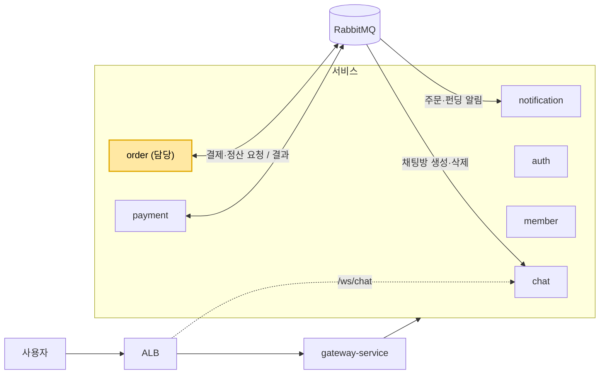
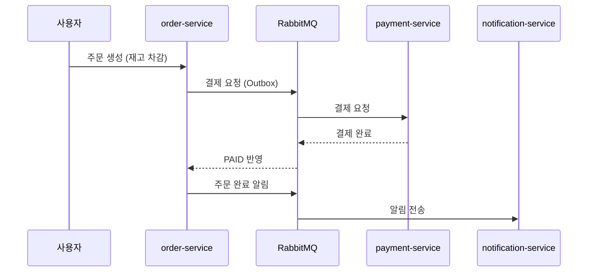
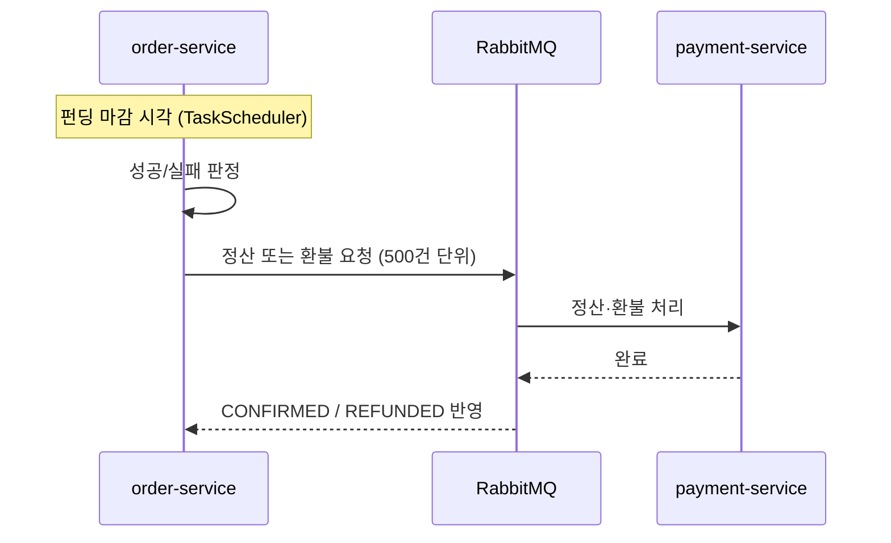
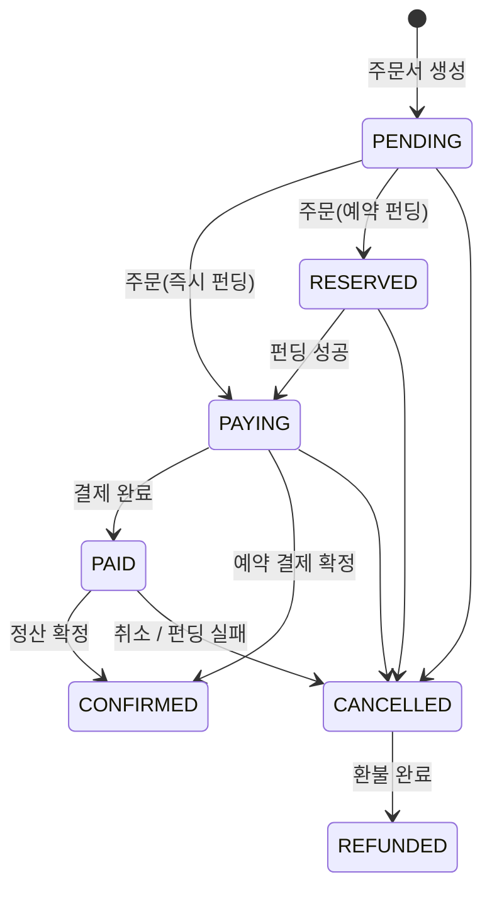
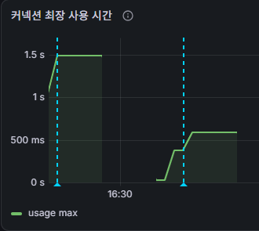

# 커뮤니티형 크라우드 펀딩 플랫폼, 빵디즈 (BDS)

> 실시간 공개 토론방이 붙은 커뮤니티형 크라우드 펀딩 플랫폼 (MSA 백엔드)

| 항목 | 내용 |
|---|---|
| 기간 | 2026.06 ~ 2026.07 (5주) |
| 유형 | 팀 프로젝트 (kt cloud Tech Up 부트캠프 백엔드 과정) |
| 인원 | 5명 (BE 5) |
| 담당 | 주문·펀딩 서비스(order-service) 전체, 서비스 간 이벤트 계약(bds-events) 일부 |
| 링크 | 원본 레포: [KT-Cloud-2-BDS/bds_backend](https://github.com/KT-Cloud-2-BDS/bds_backend) · [팀 프로젝트 상세 문서](docs/team-project.md) |

## 프로젝트 개요

### 배경
기존 펀딩 플랫폼은 후원자와 창작자, 후원자끼리 직접 소통할 수단이 부족해 달성률 외에는 상품의 실제 필요성을 가늠하기 어려웠습니다. 그래서 펀딩마다 실시간 공개 토론방을 열어 후원 전에 충분히 의견을 나눌 수 있는 플랫폼을 기획했습니다. 백엔드는 도메인별 독립 서비스로 나눈 MSA 구조로 개발했습니다.

### 목표
- All-or-Nothing 펀딩: 마감 시점에 목표 금액 미달이면 전액 자동 환불
- 서비스 간 비동기 메시징 환경에서 주문·결제·재고 데이터 정합성 유지
- 펀딩 상세 화면의 공개 토론방과 펀딩 생명주기 실시간 알림 제공

## 기술 스택

| 분류 | 기술 |
|---|---|
| Backend | Java 25, Spring Boot 4.1, Spring Data JPA, Spring Modulith 2.1, Spring Cloud (Gateway, Eureka, OpenFeign), Spring Security, OAuth2, JWT, WebSocket, JUnit 5, Testcontainers |
| Database | PostgreSQL 18, MySQL, Redis, Flyway |
| Infra / DevOps | RabbitMQ, Docker, GitHub Actions, Prometheus, Grafana, k6 |

---

## 프로젝트 소개

### 주요 기능

| 기능 | 서비스 | 설명 | 담당 |
|:---|:---|:---|:---|
| **펀딩 주문** | order | 상품 상세에서 리워드 선택 → 주문서 확인 → 결제 진입, 마감 시 펀딩 성공·실패 판정 | 손하영 ([@glosona](https://github.com/glosona)) |
| **자체 월렛 결제** | payment | 사이트 전용 월렛 충전 후 펀딩 참여, 프로젝트 실패·취소 시 자동 환불 | 김재성 ([@semolu99](https://github.com/semolu99)) |
| **실시간 채팅** | chat | 펀딩별 공개 토론방, 메이커-서포터 1:1 문의 채팅 | 주병규 ([@jnj3j3](https://github.com/jnj3j3)) |
| **실시간 알림** | notification | 펀딩 시작·성공·실패, 주문 완료·환불 등 생명주기 알림 (SSE) | 조형욱 ([@HyoungUkJo](https://github.com/HyoungUkJo)) |
| **회원·인증** | auth, member, gateway | 이메일 인증 가입, 네이버 소셜 로그인, JWT 발급 및 게이트웨이 인증 | 노여진 ([@jinjinjala-ish](https://github.com/jinjinjala-ish)) |

### 시스템 구조



- 도메인별 서비스 분리, 게이트웨이에서 JWT 검증 후 각 서비스로 라우팅
- 서비스 간 통신은 RabbitMQ 기반 비동기 이벤트, 발행은 Spring Modulith 이벤트 외부화(Outbox) 사용

> 서비스별 역할, 인증·이벤트 흐름, 배포 구성, ERD, API 문서는 [팀 프로젝트 상세 문서](docs/team-project.md)에 정리

---

## 담당: 주문(펀딩) 서비스 구현

order-service 전체(펀딩·리워드·주문 도메인)와 서비스 간 이벤트 계약 중 주문·펀딩 이벤트 구현

| 담당 | 내용 |
|---|---|
| 주문 API | 주문서 생성 → 주문 생성(재고 차감) → 취소/환불 요청, 내 주문 목록·상세 조회 구현 |
| 펀딩 API | 펀딩 생성(리워드 포함), 상태·유형별 목록 조회, 상세 조회 구현 |
| 펀딩 생명주기 | `TaskScheduler`로 시작 시각 활성화·마감 시각 판정 예약, 서버 재시작 시 누락 일정 보정 |
| 판정 후 주문 처리 | 성공/실패·즉시/예약 펀딩별 정산·환불 요청을 500건 단위 커서 조회로 일괄 처리 |
| 이벤트 연동 | 결제·정산·환불 요청 발행, 결제 결과(paid/cancelled/settled) 수신 후 주문 상태 반영 |
| 복구 배치 | 판정 후 처리되지 않은 주문을 매일 새벽 재처리하는 복구 스케줄러 구현 |
| 테스트·CI | 단위·통합 테스트 291개 작성, Testcontainers(PostgreSQL·RabbitMQ) 통합 테스트, JaCoCo 70% 커버리지 기준을 빌드에 적용 |

### 주문·펀딩 흐름

**주문·결제**



**펀딩 마감 판정**



### 주문 상태 흐름

> **즉시 펀딩 / 예약 펀딩**
> - 즉시 펀딩(INSTANT): 주문 시 바로 결제, 마감 후 성공이면 정산·실패면 환불
> - 예약 펀딩(RESERVED): 주문 시 결제 없이 예약, 마감 후 성공한 경우에만 일괄 결제



- 상태 전이 규칙을 도메인 모델(`Order.canTransitTo`)에 두고, 허용되지 않은 전이는 예외로 차단
- 재고 차감은 `remainQty >= qty` 조건부 UPDATE로 처리해 초과 판매 방지
- 주문 행은 비관적 락(`PESSIMISTIC_WRITE`, 타임아웃 3초)으로 조회해 동시 상태 변경 방지

---

# 트러블슈팅

| # | 문제 | 해결 키워드 |
|---|---|---|
| 1 | Eureka Client 추가 후 애플리케이션 시작 실패 (빈 중복 정의) | Jackson 2.x용 자동 구성 제외 |
| 2 | 결제 요청 이벤트가 Outbox에 기록되지 않음 | 이벤트 외부화 설정 직접 등록 |
| 3 | 펀딩 마감 판정 중 펀딩 행 락 장기 점유 | 판정·주문 처리 트랜잭션 분리 (락 대기 약 0.8초 → 없음) |
| 4 | 판정 대상 주문 전체를 엔티티로 한 번에 조회 | 커서 기반 500건 단위 ID 조회 (메모리 할당 약 절반, 커넥션 점유 0.6초 → 0.07초) |

## 1. Eureka Client 추가 후 애플리케이션 시작 실패 (빈 중복 정의)

### i. 문제 상황
```text
The bean 'rabbitTemplateCustomizer', defined in class path resource
[org/springframework/modulith/events/amqp/RabbitJacksonConfiguration.class], could not be registered.
A bean with that name has already been defined in class path resource
[org/springframework/modulith/events/amqp/RabbitJackson2Configuration.class] and overriding is disabled.
```
> Eureka Client 추가 후 `rabbitTemplateCustomizer` 빈이 중복 등록되어 애플리케이션 실행과 전체 테스트 실패

| 구분 | 내용 |
|---|---|
| 환경 | Spring Boot 4.1.0, Spring Modulith 2.1.0 (AMQP 이벤트 외부화), Spring Cloud 2025.1.2 (Eureka Client) |
| 발생 경위 | 게이트웨이·서비스 디스커버리 적용을 위해 루트 `build.gradle`에 `spring-cloud-dependencies` BOM과 Eureka Client를 추가한 직후 |
| 영향 범위 | 애플리케이션 실행, 슬라이스·통합 테스트 전체 |

### ii. 원인 분석

> Jackson 2.x와 3.x가 함께 classpath에 올라가, 서로 배제 조건이 없는 Modulith의 두 자동 구성이 같은 이름의 빈을 동시에 등록

**1) 같은 이름의 빈을 등록하는 두 자동 구성**

Spring Modulith AMQP에는 Jackson 3.x용 `RabbitJacksonConfiguration`과 Jackson 2.x용(Deprecated) `RabbitJackson2Configuration`이 있고, 두 설정이 같은 이름의 빈(`rabbitTemplateCustomizer`)을 등록. 각 설정은 해당 버전의 Jackson 클래스가 classpath에 있으면 활성화되는데, 서로를 배제하는 조건이 없음

```java
// Jackson 3.x용
@ConditionalOnClass({ RabbitTemplate.class, tools.jackson.databind.json.JsonMapper.class })
public class RabbitJacksonConfiguration { @Bean RabbitTemplateCustomizer rabbitTemplateCustomizer(JsonMapper mapper) { ... } }

// Jackson 2.x용 (Deprecated)
@ConditionalOnClass({ RabbitTemplate.class, com.fasterxml.jackson.databind.ObjectMapper.class })
public class RabbitJackson2Configuration { @Bean RabbitTemplateCustomizer rabbitTemplateCustomizer(ObjectMapper mapper) { ... } }
```

**2) Eureka Client가 Jackson 2.x를 함께 가져옴**

Boot 4.x 기본인 Jackson 3.x(`tools.jackson`)에 더해, Eureka Client가 Jackson 2.x(`com.fasterxml.jackson`)를 함께 끌어와 두 조건이 동시에 충족

```text
spring-boot-starter (4.1.0)
 └── tools.jackson.core:jackson-databind:3.1.4                ← Jackson 3.x
spring-cloud-netflix-eureka-client (5.0.2)
 └── spring-boot-jackson2
      └── com.fasterxml.jackson.core:jackson-databind:2.21.4  ← Jackson 2.x
```

### iii. 해결 전략

> Eureka가 쓰는 Jackson 2.x는 classpath에 남기고, Modulith의 Jackson 2.x용 자동 구성만 비활성화 채택

- Eureka는 Spring 빈을 주입받지 않고 내부에서 직접 `ObjectMapper`를 생성해 사용 → Jackson 2.x 클래스가 있어야 하지만, RabbitMQ 직렬화와는 무관
- 즉 기능 충돌이 아니라, Eureka가 로드한 Jackson 2.x 클래스 때문에 Modulith의 레거시 자동 구성 조건이 잘못 발동한 문제로 판단

| 전략 후보 | 판단 | 이유 |
|---|---|---|
| Gradle에서 Jackson 2.x(`jackson-databind`) 제외 | 제외 | Eureka 코드가 Jackson 2.x 클래스를 직접 호출해 Eureka 통신 시점에 `NoClassDefFoundError` 위험 |
| `allow-bean-definition-overriding: true` | 제외 | 로딩 순서에 따라 Jackson 2.x용 빈이 3.x용을 덮어쓸 수 있고, 다른 빈 중복 문제까지 가려짐 |
| `RabbitJackson2Configuration`만 자동 구성에서 제외 | **채택** | 충돌 원인만 정확히 차단, Eureka 동작에는 영향 없음 |

### iv. 해결 방법

**1) 레거시 자동 구성 제외**

```yaml
spring:
  autoconfigure:
    exclude:
      - org.springframework.modulith.events.amqp.RabbitJackson2Configuration
```

- Jackson 3.x 기반 `RabbitJacksonConfiguration`만 남아 `RabbitTemplateCustomizer` 하나만 등록
- 프레임워크 우회 설정이므로, Spring Modulith에서 이 문제가 수정되면 설정을 제거해야 함 (설정 위치를 이슈에 기록)

**2) 팀 전체 공유**

- 같은 공통 모듈(`modules/common`)로 Eureka Client를 받는 모든 서비스에 영향이 있어, 원인·대안 비교를 이슈 [#88](https://github.com/KT-Cloud-2-BDS/bds_backend/issues/88)로 정리해 공유
- payment·notification 서비스에도 같은 설정 적용

### v. 검증 및 결과


> 애플리케이션 정상 기동, Eureka 등록 정상, 슬라이스·통합 테스트 전체 통과

- order-service 전체 테스트(Testcontainers 기반 RabbitMQ·Outbox 통합 테스트 포함) 통과
- Jackson 2.x용 자동 구성을 제외한 뒤에도 Eureka Client가 정상 동작해, order-service가 Eureka에 `UP` 상태로 등록됨을 대시보드로 확인

블로그 링크: [Spring Boot 4.x에서 Eureka Client와 Spring Modulith AMQP의 빈 충돌](https://sonaze.tistory.com/75)

---

## 2. 결제 요청 이벤트가 Outbox에 기록되지 않음

### i. 문제 상황

> `@Externalized`를 붙인 결제 요청 이벤트를 발행해도 Outbox 테이블(`event_publication`)에 기록되지 않고 RabbitMQ로도 발행되지 않음

| 구분 | 내용 |
|---|---|
| 구조 | order-service는 `ApplicationEventPublisher`로 발행만 하고, Outbox 기록·발행은 Spring Modulith 이벤트 외부화에 위임 |
| 증상 | 예외나 경고 로그 없이 이벤트가 외부화 대상에서 빠짐 |
| 영향 범위 | 결제 서비스가 결제 요청을 받지 못함 |

### ii. 원인 분석

> 외부화 설정 빈이 없어 Spring Modulith 기본 설정이 적용됐고, 기본 설정은 애플리케이션 패키지(`com.bds.order`) 안의 이벤트만 외부화 대상으로 선택

**1) 이벤트 계약은 order-service 패키지 밖에 위치**

결제 요청 이벤트는 서비스 간 계약을 모아 둔 공통 라이브러리(`libs/bds-events`, 패키지 `com.bds.common.events`)에 정의

```java
// libs/bds-events: 이벤트 계약 (order-service 패키지 밖)
@Externalized("payment.exchange::payment.process.pay")
public record PaymentProcessPayEvent(String requestId, Long orderId, ...) { }

// order-service: 발행
@Transactional
public void publishPay(PaymentProcessPayEvent event) {
    applicationEventPublisher.publishEvent(event);
}
```

**2) 기본 외부화 설정은 애플리케이션 패키지 안의 이벤트만 선택**

외부화 설정 빈(`EventExternalizationConfiguration`)을 따로 두지 않아 Spring Modulith 기본 설정이 적용됨. 기본 설정은 지정된 패키지(애플리케이션 패키지 `com.bds.order`) 안에 있고 `@Externalized`가 붙은 이벤트만 대상으로 삼아, `com.bds.common.events`의 이벤트 미감지

### iii. 해결 전략

> 이벤트를 고르는 기준을 "패키지 + 어노테이션"에서 "어노테이션"으로 바꿔, 공통 라이브러리의 이벤트도 외부화 대상에 포함

- 이벤트를 order-service 패키지로 옮기는 방법은 제외: 여러 서비스가 함께 쓰는 이벤트 계약을 공통 라이브러리에 두는 팀 구조를 깨기 때문
- 라우팅은 기존처럼 `@Externalized` 값(`exchange::routingKey`)을 그대로 사용

### iv. 해결 방법 ([`2367f80`](https://github.com/KT-Cloud-2-BDS/bds_backend/commit/2367f80))

**외부화 설정 빈 직접 등록**

```java
// 변경 전: EventExternalizationConfiguration 빈 없음 → 기본 설정(애플리케이션 패키지 한정) 적용

// 변경 후: RabbitTopologyConfig
@Bean
public EventExternalizationConfiguration eventExternalizationConfiguration() {
    return EventExternalizationConfiguration.externalizing()
            .selectAndRoute(Externalized.class, Externalized::value)
            .build();
}
```

- `@Externalized`가 붙은 이벤트는 패키지와 관계없이 선택, 라우팅 대상은 어노테이션 값에서 결정

### v. 검증 및 결과

> 공통 라이브러리 이벤트의 Outbox 기록·RabbitMQ 발행 정상화, 결제(3종)·알림 이벤트 발행 통합 테스트로 확인

**통합 테스트로 발행 경로 확인** ([`a3d092f`](https://github.com/KT-Cloud-2-BDS/bds_backend/commit/a3d092f))

```java
@Test
void publishPay_호출시_outbox에_저장된다() {
    paymentEventPublisher.publishPay(PaymentProcessPayEvent.of(1L, 1L, 1L, 30000L));

    int count = jdbcTemplate.queryForObject(
            "SELECT COUNT(*) FROM event_publication WHERE event_type LIKE '%PaymentProcessPayEvent%'",
            Integer.class);
    assertThat(count).isGreaterThanOrEqualTo(1);
}
```

- 외부화 대상에서 빠진 이벤트는 에러 없이 사라지므로, Testcontainers(PostgreSQL·RabbitMQ) 환경에서 이벤트가 Outbox에 실제로 기록되는지 확인
- 결제 요청·정산·환불 이벤트 각각 `event_publication` 기록 확인
- 설정이 다시 빠지면 통합 테스트 실패로 감지

### vi. 추가로 발견한 문제

**1) 같은 외부화 설정이 서비스마다 복사됨**

- 같은 설정이 order-service와 payment-service에 각각 복사된 상태. 이벤트 계약이 모든 서비스 패키지 밖(`libs/bds-events`)에 있는 구조라, 이벤트를 발행하는 서비스가 늘어날 때마다 같은 누락이 반복될 수 있음
- 서비스별 설정을 공통 메시징 모듈(`modules/messaging`)의 자동 설정으로 옮겨 모든 서비스에 같은 규칙 적용 필요 → 개선 계획에 추가

---

## 3. 펀딩 마감 판정 중 펀딩 행 락 장기 점유

### i. 문제 상황

> 판정 트랜잭션 하나가 펀딩 행 락을 쥔 채 주문 처리까지 마쳐, 그동안 같은 펀딩 수정 요청이 모두 대기

| 구분 | 내용 |
|---|---|
| 발생 시점 | 펀딩 마감 시각에 스케줄러가 판정 실행: 펀딩 행을 `FOR UPDATE`로 잠그고 성공/실패를 정한 뒤, 해당 펀딩의 주문 전체 처리 |
| 영향 범위 | 판정 중 도착한 결제 완료 메시지처럼 같은 펀딩의 모금액을 고치는 요청 |
| 규모 | 주문이 많을수록 대기 시간 증가 |

### ii. 원인 분석

> 펀딩 상태 변경과 주문 N건 처리가 `@Transactional` 하나로 묶여, 펀딩 행 락이 주문 처리가 끝날 때까지 유지

판정 메서드 전체가 트랜잭션 하나라, 처음에 잡은 펀딩 행 락(`FOR UPDATE`)이 주문을 모두 처리하고 커밋할 때까지 풀리지 않음

```java
// 변경 전: FundingStatusUpdater
@Transactional
public void judgeFunding(Long fundingId) {
    Funding funding = fundingRepository.findByIdForUpdate(fundingId)...;   // 펀딩 행 락
    ...
    if (isSuccess) handleFundingSuccess(funding);    // 상태 변경 + 주문 N건 처리
    else handleFundingFailure(funding);
}   // 여기서야 커밋, 락 해제

private void handleFundingSuccess(Funding funding) {
    funding.markSuccess();
    fundingRepository.save(funding);
    List<Order> paidOrders = orderRepository.findByFundingIdAndStatus(funding.getId(), OrderStatus.PAID);
    for (Order order : paidOrders) { orderService.publishSettlement(order.getId()); }
    ...
}
```

### iii. 해결 전략

> 락이 필요한 일(펀딩 상태 변경)과 필요 없는 일(주문 처리)을 트랜잭션으로 분리

- 락이 지켜야 하는 것은 "펀딩 상태와 모금액이 동시에 바뀌지 않는 것"뿐이고, 주문 처리는 판정 결과만 알면 됨 → 판정만 먼저 커밋해도 정합성에 문제가 없다고 판단

### iv. 해결 방법 ([`fb0d03c`](https://github.com/KT-Cloud-2-BDS/bds_backend/commit/fb0d03c))

| | 트랜잭션 범위 |
|---|---|
| 변경 전 (트랜잭션 1개) | 펀딩 락 획득 → 성공/실패 판정 → 주문 N건 처리 → **커밋·락 해제** |
| 변경 후 (트랜잭션 분리) | 펀딩 락 획득 → 판정 → **커밋·락 해제** → 주문 1건씩 개별 트랜잭션 |

**1) 판정과 주문 처리를 나눠 호출하는 Orchestrator 추가**

```java
// 변경 후: FundingJudgmentOrchestrator
public void execute(Long fundingId) {
    boolean isSuccess = fundingStatusUpdater.judgeFunding(fundingId);  // 트랜잭션 커밋 = 락 해제

    if (isSuccess) fundingStatusUpdater.handleFundingSuccess(fundingId);
    else fundingStatusUpdater.handleFundingFailure(fundingId);
}

// 변경 후: FundingStatusUpdater
@Transactional
public boolean judgeFunding(Long fundingId) {
    Funding funding = fundingRepository.findByIdForUpdate(fundingId)...;
    if (funding.getStatus() != FundingStatus.ACTIVE && funding.getStatus() != FundingStatus.HOLDING) {
        throw new IllegalStateException("[FUNDING_JUDGE] 판정 불가 상태: ...");
    }
    boolean isSuccess = funding.getCurrentAmount() >= funding.getGoalAmount();
    if (isSuccess) funding.markSuccess(); else funding.markFailed();
    fundingRepository.save(funding);
    return isSuccess;
}
```

- 판정 트랜잭션 커밋 즉시 펀딩 행 락 해제. 주문 처리는 주문 단위 트랜잭션으로 실행되어, 주문 하나의 실패가 다른 주문에 영향 없음

**2) 분리로 생기는 잘못된 분기 차단**

- 분리 후에는 판정 결과(`boolean`)를 보고 성공/실패 주문 처리를 고르는 구조. 판정할 수 없는 상태(이미 판정된 펀딩 등)에서 그냥 반환하면 실패 처리로 잘못 넘어갈 수 있음
- 로그만 남기고 반환하던 것을 `IllegalStateException`으로 바꿔 주문 처리 단계 진입 차단
- 서버 시작 보정(`FundingScheduleInitializer`)의 `@Transactional`도 제거해 조회마다 커넥션을 짧게 사용

### v. 검증 및 결과

> 판정 중 같은 펀딩 수정 요청의 락 대기 약 0.8초 → 없음

| 구분 | 내용 |
|---|---|
| 비교 대상 | 개선 전([`b19b389`](https://github.com/KT-Cloud-2-BDS/bds_backend/commit/b19b389)) / 트랜잭션 분리(`fb0d03c`). 두 커밋 사이에는 판정 관련 코드만 다름 |
| 테스트 데이터 | 주문 50,000건짜리 펀딩, 판정 3회 반복 후 중앙값 |
| 동일 조건 | 같은 로컬 PostgreSQL 18·설정, JVM 힙 512MiB 고정, 측정 전 워밍업 판정 1회, 측정 판정 직전 GC 실행(`jcmd GC.run`) |
| 도구 | 락 대기: PostgreSQL `log_lock_waits` (100ms 넘게 기다리면 로그 기록) / 커넥션: Spring Boot Actuator → Prometheus → Grafana |
| 기대 효과 | 판정 중 들어온 같은 펀딩 수정 요청이 기다리지 않음 |
| 확인 지표 | 수정 요청의 락 대기 시간 |

<details>
<summary>테스트 절차</summary>

두 커밋 각각 같은 순서로 진행

1. 측정용 펀딩과 주문을 넣고 order-service 실행
2. 펀딩 마감 시각에 스케줄러가 판정 실행
3. 판정 중 같은 펀딩 행에 50ms 간격으로 수정 요청 전송 (판정 중 결제 완료 메시지가 도착하는 상황)
4. PostgreSQL 락 대기 로그와 Grafana 지표 기록
5. 판정 3회 반복, 중앙값으로 비교

</details>

<br>

**결과** (3회 중앙값)

| 지표 | 개선 전 | 개선 후(트랜잭션 분리) |
|---|---|---|
| 1) 수정 요청의 락 대기 (PostgreSQL 로그) | **846ms** | **대기 없음** |
| 2) 커넥션 최장 사용 시간 | 약 1.5초 | 약 0.6초 |

**1) 락 대기**

개선 전 판정 3회 모두 수정 요청이 0.8~1.4초 대기, 분리 후 대기 0회

```text
LOG:  process 46289 still waiting for ShareLock on transaction 14225 after 100.087 ms
LOG:  process 46289 acquired ShareLock on transaction 14225 after 1440.954 ms
```
<sub>*개선 전 측정에서 남은 PostgreSQL 로그. 트랜잭션 분리 후에는 이 로그가 한 줄도 남지 않음*</sub>

- 개선 전: 수정 요청 세션(`process 46289`)이 펀딩 행 락을 쥔 판정 트랜잭션(`transaction 14225`)이 커밋될 때까지 약 1.44초 대기
- 트랜잭션 분리 후: 100ms를 넘긴 대기 0회

<details>
<summary>로그 읽는 법</summary>

- `still waiting ... after 100.087 ms`: 대기 시간이 기록 기준값(`deadlock_timeout`, 측정 때 100ms로 설정)을 넘은 순간 남는 줄
- `acquired ... after N ms`: 락을 얻은 순간 남는 줄. N이 실제 대기 시간
- `ShareLock on transaction`: PostgreSQL에서 행 락을 기다리는 세션은, 락을 쥔 트랜잭션의 ID에 대한 ShareLock을 얻으려 기다리는 방식으로 대기

</details>

<br>

**2) 커넥션 최장 사용 시간**

개선 전 약 1.5초 → 분리 후 약 0.6초



<sub>*점선은 각 커밋의 첫 측정 판정 시각. 왼쪽부터 개선 전 / 트랜잭션 분리*</sub>

- 개선 전 약 1.5초: 펀딩 행 락을 쥔 판정 트랜잭션 전체
- 분리 후 약 0.6초: 락을 해제한 뒤 실행되는 주문 일괄 조회 쿼리라 락 대기와 무관 → 4번에서 개선

<details>
<summary>커넥션 최장 사용 시간이란</summary>

- 커넥션 풀에서 커넥션을 빌려 반납하기까지 걸린 시간 중 최댓값 (HikariCP `connections.usage` 타이머의 max)
- 최댓값이 일정 시간 유지되는 방식이라, 판정이 끝난 뒤에도 그래프가 평평하게 이어짐

</details>


### vi. 추가로 발견한 문제

**1) 락 대기는 사라졌지만, 판정 전체 시간은 줄지 않음 (709ms → 759ms)**


<sub>*20초 동안 커넥션 풀에서 DB 커넥션을 빌린 횟수. 왼쪽부터 개선 전 / 트랜잭션 분리. 오른쪽 첫 작은 봉우리는 측정 전 워밍업 판정(주문 1만 건)*</sub>

- 분리 전에는 주문별 처리 메서드(`@Transactional`)가 판정 트랜잭션에 참여해 커넥션을 한 번만 사용(Spring 기본 전파 방식 `REQUIRED`)
- 분리 후에는 주문마다 새 트랜잭션 생성 → 판정 한 번에 커넥션을 주문 수만큼 대여
- 락 시간을 줄인 대신 생긴 비용으로 판단 → 개선 계획에 추가
- 개선 전: 판정 전체가 트랜잭션 하나라 커넥션을 한 번만 사용 → 0에 붙어 있음
- 트랜잭션 분리 후: 큰 봉우리 3개가 측정 판정 3회. 주문마다 트랜잭션을 새로 열어 판정마다 주문 수만큼(약 5만 회) 대여

<details>
<summary>그래프 값이 약 6만 회로 보이는 이유</summary>

- Prometheus `increase()`는 구간 양 끝을 외삽해 계산해서, 20초 집계 값이 실제 대여 횟수(약 5만 회)보다 크게 표시될 수 있음

</details>

---

## 4. 판정 대상 주문 전체를 엔티티로 한 번에 조회

### i. 문제 상황

> 트랜잭션 분리 후 주문 처리가 별도 단계가 되면서, 주문 처리에는 주문 ID만 필요한데 주문 전체를 리워드까지 엔티티로 한 번에 올리는 조회가 드러남

| 구분 | 내용 |
|---|---|
| 발생 시점 | 3번의 트랜잭션 분리 후, 판정의 주문 처리 단계 |
| 증상 | 판정 1회에 주문 5만 건을 한 번에 조회하는 쿼리가 커넥션을 약 0.6초 점유 |
| 영향 범위 | 주문 수에 비례해 메모리 사용 증가. 대량 주문 펀딩에서 OOM 위험 |

### ii. 원인 분석

> 주문 처리에는 주문 ID만 필요한데, 해당 펀딩의 주문 전체를 리워드까지 `JOIN FETCH`한 엔티티로 한 번에 조회

조회 쿼리가 페이징 없이 주문 엔티티 전체를 반환하고, 반복문은 그중 주문 ID만 사용

```java
// 변경 전: OrderJpaRepository
@Query("SELECT DISTINCT o FROM OrderJpaEntity o " +
       "JOIN FETCH o.orderRewards orw JOIN orw.reward r " +
       "WHERE r.funding.id = :fundingId AND o.status = :status")
List<OrderJpaEntity> findByFundingIdAndStatus(Long fundingId, OrderStatus status);

// 변경 전: FundingStatusUpdater.handleFundingSuccess
List<Order> paidOrders = orderRepository.findByFundingIdAndStatus(fundingId, OrderStatus.PAID);
for (Order order : paidOrders) { orderService.publishSettlement(order.getId()); }
```

### iii. 해결 전략

> 엔티티 대신 주문 ID만, 500건씩 나눠 조회

- 주문 처리 메서드는 주문 ID만 받으므로 엔티티 로딩 불필요
- 엔티티 조회에 페이징을 붙이면 `FETCH JOIN + Pageable` 조합에서 Hibernate 6 서브쿼리 alias 문제가 생겨, ID만 조회하는 방식 선택
- offset 페이징 대신 커서(`id > lastOrderId`) 방식 선택: 처리 중 주문 상태가 바뀌면 offset 기준이 밀려 누락이 생길 수 있기 때문

### iv. 해결 방법 ([`b146e3c`](https://github.com/KT-Cloud-2-BDS/bds_backend/commit/b146e3c))

**1) ID만 조회하는 커서 쿼리로 변경**

```java
// 변경 후: OrderJpaRepository
@Query("SELECT DISTINCT o.id FROM OrderJpaEntity o ... " +
       "WHERE f.id = :fundingId AND o.status = :status AND o.id > :lastOrderId ORDER BY o.id ASC")
List<Long> findOrderIdsByFundingIdAndStatus(Long fundingId, OrderStatus status, Long lastOrderId, Pageable pageable);
```

**2) 500건 단위로 반복 처리**

```java
// 변경 후: FundingStatusUpdater.handleFundingSuccess
Long lastOrderId = 0L;
while (true) {
    List<Long> paidOrderIds = orderRepository.findOrderIdsByFundingIdAndStatus(fundingId, OrderStatus.PAID, lastOrderId, 500);
    if (paidOrderIds.isEmpty()) break;
    for (Long orderId : paidOrderIds) { orderService.publishSettlement(orderId); }
    lastOrderId = paidOrderIds.get(paidOrderIds.size() - 1);
    if (paidOrderIds.size() < 500) break;
}
```

- 마지막으로 처리한 ID를 다음 조회 기준으로 사용, 500건 미만이 나오면 종료

### v. 검증 및 결과

> 판정 1회 메모리 할당 약 절반 감소, 커넥션 최장 점유 약 0.6초 → 0.07초

| 구분 | 내용 |
|---|---|
| 비교 대상 | 트랜잭션 분리(`fb0d03c`) / 청크 조회([`b146e3c`](https://github.com/KT-Cloud-2-BDS/bds_backend/commit/b146e3c)). 3번과 이어 보기 위해 개선 전 값도 참고로 표시 |
| 테스트 데이터·조건·도구·절차 | 3번과 동일 |
| 기대 효과 | 판정 1회에 쓰는 메모리와 DB 커넥션 점유 시간 감소 |
| 확인 지표 | 판정 구간 메모리 할당량, 커넥션 최장 사용 시간 |

<br>

**결과** (3회 중앙값)

| 지표 | 개선 전 | 개선 1(트랜잭션 분리) | 개선 2(청크 조회) |
|---|---|---|---|
| 1) 커넥션 최장 사용 시간 | 약 1.5초 | 약 0.6초 | **약 0.07초** |
| 2) 판정 구간 메모리 할당 (20초 집계) | 약 350MiB | 약 375MiB | **약 180MiB** |

| 커넥션 최장 사용 시간 | 판정 구간 메모리 할당 |
|---|---|
|  |  |

<sub>*점선은 각 커밋의 첫 측정 판정 시각. 왼쪽부터 개선 전 / 트랜잭션 분리 / 청크 조회*</sub>

**1) 커넥션 최장 사용 시간** (왼쪽 그래프)

- 개선 전 약 1.5초: 펀딩 행 락을 쥔 판정 트랜잭션 전체
- 트랜잭션 분리 약 0.6초: 3번으로 락은 풀었지만, 주문 5만 건을 한 번에 조회하는 쿼리가 남아 있던 상태
- 청크 조회 약 0.07초: 가장 긴 커넥션 사용이 500건 조회 1회로 감소

**2) 판정 구간 메모리 할당** (오른쪽 그래프)

- 개선 전·트랜잭션 분리 모두 약 350~375MiB: 3번은 트랜잭션 범위만 바꿔 메모리 사용은 그대로
- 청크 조회 약 180MiB: 엔티티 대신 ID만, 500건씩 올려 약 절반으로 감소

**3) OOM 방지 효과**: 미확인. 힙 512MiB에서는 개선 전에도 OOM이 나지 않아, 메모리 사용 감소까지만 확인


<details>
<summary>판정 구간 메모리 할당이란</summary>

- 20초 동안 JVM이 새로 할당한 힙 메모리 양 (`jvm_gc_memory_allocated_bytes_total`의 20초 증가량)
- 누적 카운터의 증가량이라, Prometheus 수집 간격(5초) 사이에 끝난 짧은 작업도 빠지지 않고 반영

</details>

<details>
<summary>비교 제외 지표 (3번·4번 공통)</summary>

| 지표 | 제외 이유 |
|---|---|
| GC 횟수·정지 시간 | 그래프의 GC는 모두 측정 직전에 직접 실행한 GC. 힙을 512MiB로 고정해 판정 중 GC 미발생 |
| Old Gen·힙 사용량 | 측정 직전에 힙을 정리했고, 5초 수집이라 판정 순간 값을 거의 잡지 못함 |
| 커넥션 획득 대기, 활성·대기 커넥션 수 | 동시 요청을 넣지 않아 커넥션 풀 경합이 없는 조건 |
| CPU 사용률 | 수집 시점의 순간값이라 판정 구간을 대표하지 못함 |

</details>

### vi. 추가로 발견한 문제

**1) 판정 전체 시간이 트랜잭션 분리 대비 약 2배로 증가 (759ms → 1,555ms)**

- 판정을 반복할수록 시간 증가(1,499 → 1,555 → 2,034ms). 측정 데이터상 뒤 회차일수록 그 펀딩 앞에 다른 펀딩의 주문이 많음(1만 → 6만 → 11만 건)
- 청크 조회 쿼리가 앞선 주문 수만큼 느려지는 것으로 추정되나 실행 계획은 아직 미확인 → 개선 계획에 추가

## 결과 및 성과

- 주문·펀딩 도메인을 독립 서비스로 완성하고 결제·알림 서비스와 이벤트 기반으로 연동
- 펀딩 판정의 락 점유와 메모리 부담을 개선하고 단계별로 측정해 검증 (주문 5만 건, 3회 중앙값 기준 락 대기 약 0.8초 → 없음, 판정 중 커넥션 최장 점유 약 1.5초 → 약 0.07초, 판정당 메모리 할당 약 절반)
- 단위·통합 테스트 291개 작성, CI에서 JaCoCo 커버리지 70% 미만이면 빌드 실패하도록 구성
- k6로 주문 API 부하 테스트 진행 <!-- TODO: 확인 필요 - 재측정 후 수치 기입 (목표: 동시 100건 주문 정합성, 주문 생성 p95 ≤ 200ms) -->

## 개선 계획

**데이터 정합성**
- [ ] 취소 메시지 중복 수신 시 재고가 두 번 복원되는 문제 수정 (상태 검증 후 재고 복원)
- [ ] 수신 이벤트 ID 기록으로 중복 메시지 무시 (팀 공통 `ProcessedEventStore` 활용)
- [ ] 메시지 처리 실패 시 예외를 다시 던져 롤백 및 RabbitMQ 재전달·DLQ로 넘기기
- [ ] 주문에 펀딩 ID를 저장해 클라이언트가 보낸 펀딩 ID에 의존하지 않도록 수정

**운영 안정성**
- [ ] 서버 시작 보정 중 예외 하나로 나머지 보정이 멈추지 않도록 건별 예외 처리
- [ ] 다중 인스턴스에서 펀딩 판정·복구 배치가 중복 실행되지 않도록 분산 락 또는 DB 기반 스케줄링 적용
- [ ] 15분 지난 주문서(PENDING) 만료 처리
- [ ] 시간대를 서버 기본값이 아닌 설정값으로 명시
- [ ] 펀딩 판정 청크 조회 쿼리의 실행 계획 확인 및 인덱스 보완 (앞선 주문이 많을수록 판정 시간이 늘어나는 현상)
- [ ] 주문별 처리를 청크 단위 트랜잭션으로 묶어, 트랜잭션 분리 후 늘어난 커넥션 대여 횟수 줄이기

**코드 품질**
- [ ] 펀딩 목록 조회 파라미터를 enum으로 받아 잘못된 값은 400 응답
- [ ] 주문 목록 응답에 전체 개수(페이지 정보) 포함
- [ ] 상태 변경 없는 조회의 쓰기 락 제거
- [ ] 서비스별로 복사된 이벤트 외부화 설정(`EventExternalizationConfiguration`)을 공통 메시징 모듈 자동 설정으로 이동

---

## 실행 방법

* 요구 환경: Java 25, Docker (Docker Desktop은 실행 중 상태)
* Mac, Linux, Windows(PowerShell·Git Bash) 모두 동일
* 로컬 실행에 필요한 설정값: `application-quickstart.yml`(기본 프로필), `infra/rabbitmq/.env.example`, `docker-compose.local.yml`에 기본값 주입, 추가 구성 필요 X

### A. MSA 전체 실행

```bash
git clone https://github.com/glosona/bdz_backend.git
cd bdz_backend

# 1. 인프라 (RabbitMQ, order PostgreSQL, payment MySQL, auth PostgreSQL·Redis)
docker compose -f infra/rabbitmq/docker-compose.yml --env-file infra/rabbitmq/.env.example up -d
docker compose -f services/order-service/docker-compose.local.yml up -d
docker compose -f services/payment-service/docker-compose.local.yml up -d
docker compose -f services/auth-service/docker-compose.local.yml up -d
```

```bash
# 2. 애플리케이션: 터미널을 5개 열어 아래 순서대로 하나씩 실행 (bootRun은 종료되지 않습니다)
./gradlew :platform:discovery-service:bootRun   # Eureka, 8761
./gradlew :services:auth-service:bootRun        # 8081
./gradlew :services:order-service:bootRun       # 8080
./gradlew :services:payment-service:bootRun     # 8085
./gradlew :platform:gateway-service:bootRun     # 8000, auth-service가 Eureka에 등록된 뒤에 실행
```

게이트웨이를 통한 호출이 인증 헤더 없이 `401`을 반환하면 연결된 것입니다.

```bash
curl -i http://localhost:8000/api/orders
```

<details>
<summary>구성 요소와 순서가 필요한 이유</summary>

| 구성 요소 | 역할 |
|---|---|
| RabbitMQ (`msa` vhost, 서비스별 계정) | 결제·알림 이벤트 송수신 |
| discovery-service (Eureka) | 서비스 등록·조회, 게이트웨이 라우팅 대상 |
| payment-service + MySQL | 결제·정산·환불 응답 (없으면 주문이 PAYING 상태에서 멈춥니다) |
| auth-service + PostgreSQL·Redis | 로그인과 JWT 발급 |
| gateway-service | 토큰 검증 후 사용자 헤더 전달 |

- gateway-service는 기동할 때 Eureka에서 auth-service를 조회하므로 auth-service보다 먼저 띄우면 종료됩니다.
- auth-service의 PostgreSQL은 order-service DB(5432)와 겹치지 않도록 호스트 5433 포트를 씁니다.
- 네이버 로그인, 이메일 발송, 은행 연동(`BANK_URL`)은 자리표시 값이 들어 있습니다. 실제로 쓰려면 환경변수로 덮어씁니다.
- auth-service의 JWT 서명 키는 저장소에 공개된 테스트 전용 키입니다. 로컬 밖에서는 `JWT_RSA_PRIVATE_KEY`로 별도 키를 주입합니다.
- 개인 설정이 필요하면 gitignore 대상인 `application-local.yml`을 만들고 `SPRING_PROFILES_ACTIVE=local`로 실행합니다.

</details>

### B. order-service 단독 실행

```bash
# 1. RabbitMQ
docker compose -f infra/rabbitmq/docker-compose.yml --env-file infra/rabbitmq/.env.example up -d

# 2. PostgreSQL
docker compose -f services/order-service/docker-compose.local.yml up -d

# 3. Eureka (별도 터미널)
./gradlew :platform:discovery-service:bootRun

# 4. order-service (별도 터미널)
./gradlew :services:order-service:bootRun
```

게이트웨이 없이 직접 호출할 때는 사용자 헤더와 내부 시크릿(`InternalGatewaySecretFilter`)을 함께 보냅니다. `200 []`이 반환되면 정상입니다.

```bash
curl -i http://localhost:8080/api/orders -H "X-User-Id: 1" -H "X-Internal-Secret: local-dev-internal-secret"
```

<details>
<summary>참고</summary>

- Flyway가 기동 시 스키마를 만들며, 기본 접속 정보는 [application-quickstart.yml](services/order-service/src/main/resources/application-quickstart.yml)에 있습니다.
- 내부 시크릿 헤더가 없으면 `401 INVALID_INTERNAL_SECRET`이 반환됩니다.
- 이 상태에서는 payment-service가 없어 주문이 PAYING 상태에서 멈춥니다. 결제까지 보려면 A로 실행합니다.

</details>

### C. 테스트 실행

Docker만 실행 중이면 됩니다. Testcontainers가 PostgreSQL과 RabbitMQ를 직접 띄우므로 A, B의 인프라는 필요 없습니다.

```bash
./gradlew :services:order-service:test :services:order-service:jacocoTestReport
```

- 커버리지 리포트: `services/order-service/build/reports/jacoco/test/html/index.html`
- API 명세: [주문](services/order-service/docs/api-spec-order.md), [펀딩](services/order-service/docs/api-spec-funding.md)

## 프로젝트 구조

<details>
<summary>폴더 구조 펼치기</summary>

```
bdz_backend
├── platform/                 # gateway-service, discovery-service
├── services/
│   ├── order-service/        # 담당 서비스
│   │   └── src/main/java/com/bds/order
│   │       ├── presentation/     # Controller, DTO
│   │       ├── application/      # OrderService, FundingService, OrderMessageHandler
│   │       ├── domain/           # Order, Funding, Reward, OrderReward (순수 도메인 모델)
│   │       ├── infrastructure/   # JPA 엔티티·Mapper·PersistenceAdapter, 메시징, 스케줄러
│   │       └── global/           # 예외 처리
│   ├── payment-service/
│   ├── chat-service/
│   ├── notification-service/
│   ├── auth-service/
│   └── member-service/
├── libs/bds-events/          # 서비스 간 이벤트 클래스
├── modules/                  # common, messaging (RabbitMQ 공통 설정)
├── infra/                    # Dockerfile, RabbitMQ 설정
└── .github/workflows/        # 서비스별 CI
```

</details>

---

교육 목적으로 제작된 프로젝트입니다. Copyright (c) 2026 팀 빵빠레 (BDS). All rights reserved.<br/>
코드 및 결과물의 상업적 이용과 무단 복제·배포를 금지합니다. ([팀 프로젝트 상세 문서](docs/team-project.md))
