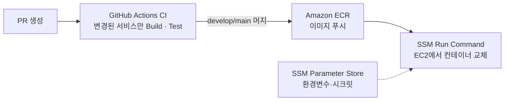

# 빵디즈 (BDS) 팀 프로젝트 상세

> 포트폴리오 README([../README.md](../README.md))에서 다루지 않는 팀 전체 구성을 정리한 문서

## 서비스 구성

| 서비스 | 역할 | 담당 |
|---|---|---|
| order-service | 펀딩·리워드 관리, 주문/취소, 펀딩 판정 스케줄링 | 손하영 |
| payment-service | 개인 월렛, 결제·정산·환불 | 김재성 |
| chat-service | 펀딩별 공개 토론방, 1:1 문의 채팅 (WebSocket) | 주병규 |
| notification-service | 펀딩 생명주기 알림 (SSE) | 조형욱 |
| auth-service / member-service | 로그인·OAuth2·JWT, 회원 정보 | 노여진 |
| gateway-service / discovery-service | 라우팅·인증 필터, 서비스 디스커버리 | 노여진 |
| libs/bds-events, modules/messaging | 서비스 간 이벤트 계약, RabbitMQ 공통 설정 | 공동 (주문·펀딩 이벤트는 손하영) |

## 시스템 구조 상세

- 서비스별 DB 분리: payment는 MySQL, 나머지는 PostgreSQL, auth는 토큰·인증번호 저장에 Redis 추가 사용
- 인증: 게이트웨이와 chat-service가 auth-service의 JWKS(서명 공개키)로 JWT 검증, member-service는 가입·탈퇴 시 OpenFeign으로 auth-service 호출

- 게이트웨이가 JWT를 검증한 뒤 `X-User-Id` 등 사용자 헤더와 내부 시크릿(`X-Internal-Secret`)을 붙여 각 서비스로 전달
- WebSocket(`/ws/chat`)은 게이트웨이를 거치지 않고 chat-service로 직접 연결, 연결 시 chat-service가 JWT를 직접 검증
- 서비스 간 비동기 통신은 RabbitMQ Topic Exchange, 이벤트 클래스는 공통 라이브러리(`libs/bds-events`)로 공유하고 발행은 Spring Modulith 이벤트 외부화(Outbox) 사용
- chat-service는 RabbitMQ를 STOMP 브로커 릴레이로도 사용

이벤트 흐름 펼치기

| 발행 | 구독 | 이벤트 |
|---|---|---|
| order | payment | 결제 요청, 정산·환불 배치 요청 |
| payment | order | 결제 완료, 결제 취소, 정산·환불 완료 |
| order | notification | 주문 완료·환불, 펀딩 시작·성공·실패 |
| order | chat | 펀딩 시작 시 공개방 생성, 종료 시 삭제 |
| chat | notification | 1:1 문의 새 메시지 |

## 배포

- 서비스별 Docker 컨테이너를 EC2에 배포, 지표는 Prometheus·Grafana로 수집 (order·chat·payment는 `/actuator/prometheus` 노출)

## 문서

- [API 명세서](api-spec.md)
- [프로젝트 개요](project-overview.md)
- [ERD Cloud (팀 공유)](https://www.erdcloud.com/team/kW5wm7MoS6XACbo7T)

## 라이선스

교육 목적으로 제작된 프로젝트입니다. 
Copyright (c) 2026 팀 빵빠레 (BDS). All rights reserved.

- 본 프로젝트의 코드 및 결과물은 교육 목적으로만 사용되며, 상업적 이용 및 무단 복제/배포를 금지합니다.
